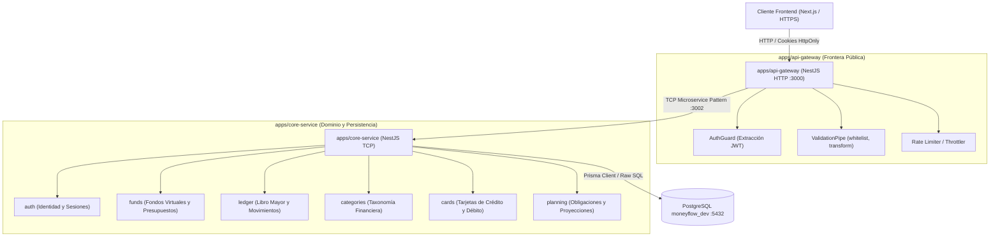

# Arquitectura Técnica — moneyflow-backend

Documento de diseño arquitectónico, topología de servicios, gestión de datos y directrices técnicas del backend de MoneyFlow.

## 1. Topología del Sistema

El backend de MoneyFlow está implementado como un monorepo NestJS dividido en **dos aplicaciones principales** con responsabilidades estrictamente desacopladas:

### 1.1. `apps/api-gateway` (HTTP / REST)
- **Función:** Punto único de entrada exterior (Edge Gateway).
- **Protocolo:** HTTP/REST en el puerto `3000` (configurable vía `GATEWAY_PORT`).
- **Responsabilidades:**
  - Terminación CORS, gestión de cookies `HttpOnly` y rate-limiting global.
  - Validación de esquemas de entrada mediante `ValidationPipe` global con opciones:
    `{ whitelist: true, forbidNonWhitelisted: true, transform: true }`.
  - Verificación del token JWT en `AuthGuard`, validación de firma y extracción del `user_id`.
  - Empaquetado y propagación del payload autenticado hacia `apps/core-service` mediante el cliente TCP interno de NestJS.
  - **Restricción:** No contiene lógica de negocio, cálculos de saldos ni conexión directa con la base de datos PostgreSQL.

### 1.2. `apps/core-service` (TCP / Microservicio de Dominio)
- **Función:** Núcleo de lógica financiera, transacciones ACID y persistencia.
- **Protocolo:** TCP en el puerto `3002` (configurable vía `CORE_TCP_PORT`).
- **Módulos Internos de Dominio:**
  1. `auth`: Gestión de credenciales, hashing (Argon2id/Bcrypt), refresco y ciclo de vida de usuarios.
  2. `funds`: Creación, configuración y gestión de fondos virtuales.
  3. `ledger`: Libro contable de doble entrada, registro inmutable de entradas (`fund_entries`), cálculo derivado de saldos vía agregación (`SUM`) y trazabilidad de transferencias netas cero.
  4. `categories`: Árbol de categorías y subcategorías para clasificación de gastos e ingresos.
  5. `cards`: Gestión de tarjetas de crédito/débito, fechas de corte, fechas límite de pago y asignación de fondos de respaldo.
  6. `planning`: Presupuestos mensuales, obligaciones recurrentes y alertas financieras preventivas.
- **Acceso Exclusivo a Datos:** Es la **única** aplicación autorizada para comunicarse con PostgreSQL.

---

## 2. Gestión de Persistencia y Estándar de Migraciones

### 2.1. Estándar de Migraciones SQL Versionadas
Para garantizar control milimétrico, auditoría estricta y cero desviaciones en producción:
- **Ubicación:** `db/migrations/`
- **Nomenclatura Obligatoria:** Prefijo de **4 dígitos correlativos** seguido de descripción en minúsculas y snake_case:
  `db/migrations/0001_init_schema.sql`
  `db/migrations/0002_create_ledger_tables.sql`
- **Registro Central de Orden:** Cada migración debe estar registrada en `db/ORDEN.md` con su fecha, descripción y checksum correspondiente.
- **Prohibiciones Terminantes:**
  - **Prohibido** ejecutar `prisma db push` (destructivo / no determinista).
  - **Prohibido** ejecutar `prisma migrate dev` (genera artefactos automáticos no auditados).
  - El esquema Prisma (`schema.prisma`) actúa como espejo tipado del estado real de la base de datos generado mediante introspección o alineación manual controlada.

---

## 3. Invariantes Técnicas Fundamentales

1. **Aislamiento Multi-inquilino (`user_id`):**
   - El `user_id` se extrae exclusivamente del contexto autenticado verificado por el Gateway.
   - Prohibido aceptar `user_id` desde parámetros de URL o cuerpos de petición JSON.
2. **Precisión Financiera:**
   - Tipo de columna PostgreSQL: `DECIMAL(14, 2)`.
   - Tipo en TypeScript: `Prisma.Decimal` con redondeo `ROUND_HALF_UP`.
   - Serialización HTTP: **Siempre `string` exacto** (`"1250.00"`). Prohibida aritmética con `number` en JavaScript.
3. **Inmutabilidad y Saldos Derivados:**
   - El saldo de un fondo nunca se almacena como un valor estático editable. Se calcula dinámicamente como `SUM(amount)` sobre `fund_entries`.
   - Prohibido el borrado físico (`DELETE`) de transacciones confirmadas o fondos con transacciones históricas. Se utilizan anulaciones compensatorias o banderas de archivado.
4. **Zona Horaria (`America/Lima`):**
   - Fechas de negocio: Tipo `DATE` local (`YYYY-MM-DD`), validadas contra calendario gregoriano real.
   - Instantes técnicos: Tipo `TIMESTAMPTZ` (UTC).

---

## 4. Política de Coste Cero (Zero-Cost Architecture)

MoneyFlow está diseñado para ser 100% operativo sin incurrir en costes de infraestructura propietaria ni servicios de pago:
- **Tecnologías Libres y Estándares:** Node.js LTS, NestJS, TypeScript, PostgreSQL y Prisma ORM.
- **Contenedores Locales:** Ejecución de base de datos PostgreSQL vía Docker/Podman local sin dependencias SaaS.
- **Microservicios Ligeros:** Comunicación TCP local basada en sockets sin requerir brokers pagos (como AWS SQS o Confluent Kafka) en fases de desarrollo y despliegue base.
